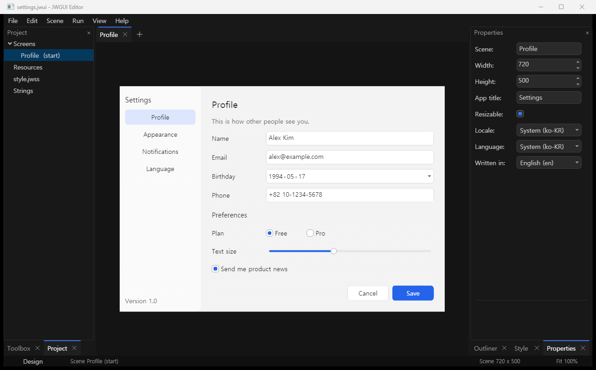
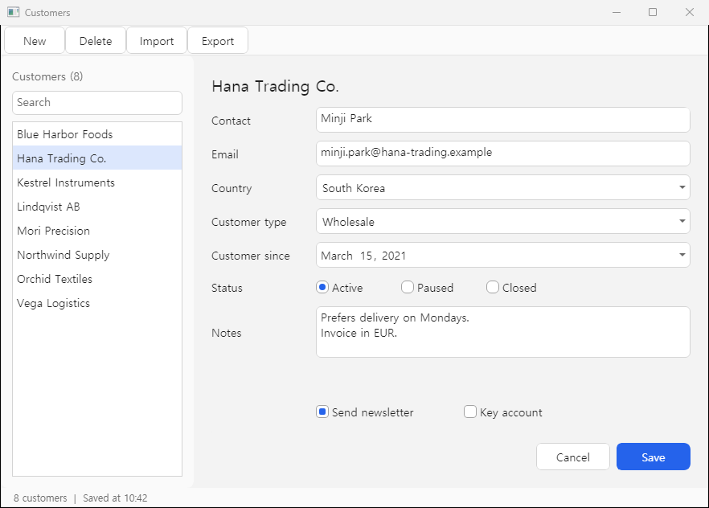
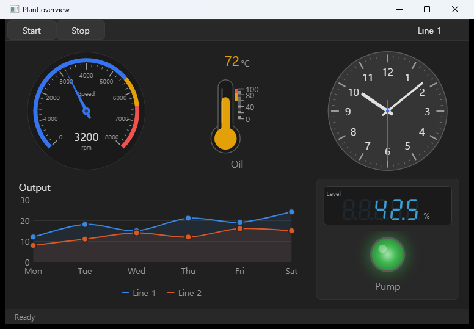
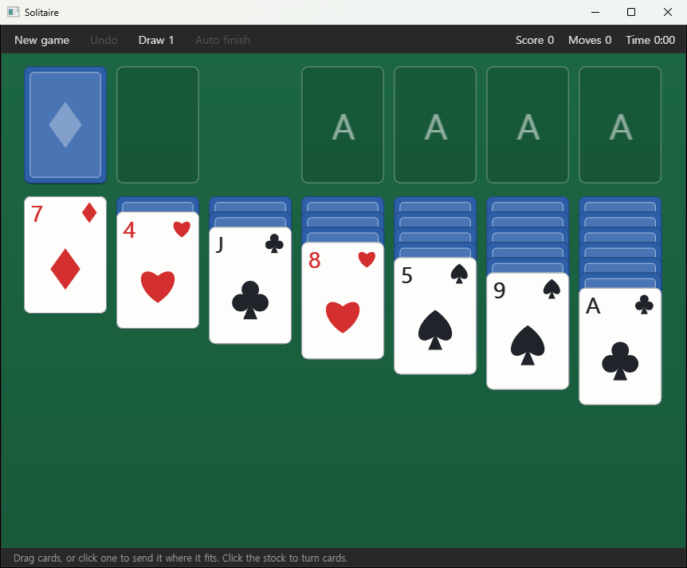
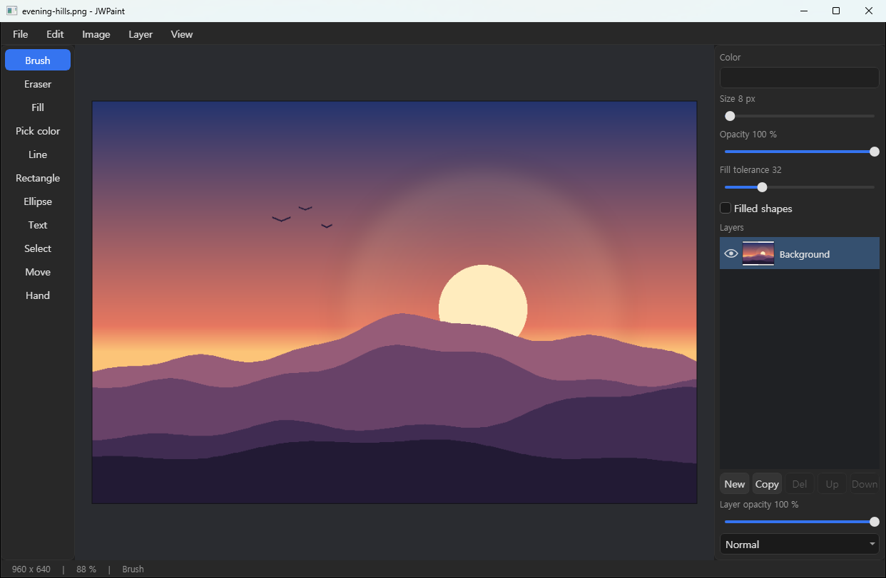

# JWGUIEngine

**A C++ GUI engine for Windows with a visual editor.** Design your screens in JWGUIEditor, save them as plain files, and let a C++ program load them and add the logic, or run them with no code at all in JWGUIPlayer. Spend your time on your app, not on its GUI.

[](#download)
[](#platforms)
[](#use-the-engine-from-c)
[](#license)

This repository is the **release package** of JWGUIEngine: the engine (`JWGUIEngine.dll` with headers and a CMake package), the editor, the player, sample apps and games, the user guide in English and Korean, and a ready-to-build example. Download it, unzip it, and it works. Nothing is installed in the system.

한국어 안내는 [아래](#jwguiengine-한국어)에 있습니다.



## What JWGUIEngine is for

Desktop developers lose a lot of time to screens: forms laid out by hand, a control the framework lacks written from scratch, pixels nudged until it looks right, and little of it carries over to the next project. JWGUIEngine is built to give that time back:

- **Design screens instead of coding them.** Lay out a window in the editor; it runs exactly as designed, drawn by the same engine that runs your app.
- **Screens are files, not code.** A project is a `.jwui` file (XML) plus a `res` folder with pictures, a CSS-like style sheet (`.jwss`) and string tables (JSON). Change the look or the layout and start the app again: no rebuild.
- **Your code stays about your program.** It meets the screen only through the names of the controls it uses (`FindByIdAs<UIButton>("saveButton")`).
- **Build a control once, use it in every project.** Your own controls are registered like the built-in ones and placed in any scene.
- **A polished look from the start.** Light and dark themes, a style sheet, smooth animation, per-monitor DPI, GPU or CPU drawing, text input with Korean / Japanese / Chinese input methods.

| | |
|---|---|
|  |  |
|  |  |

## Download

- **Download ZIP** of this repository (the green **Code** button) or `git clone https://github.com/dokdeplus/JWGUIEngine-Package.git`.
- Unzip to a folder of your choice, for example `C:\JWGUI`. Requirements: Windows 10 or 11, 64-bit. To write C++ apps: Visual Studio 2026 (MSVC x64) and CMake 3.20 or later.
- Start `bin\JWGUIEditor.exe`, or open the guide: `docs\index.html`.

| Folder | Contents |
|---|---|
| `bin\` | `JWGUIEditor.exe` (the visual editor), `JWGUIPlayer.exe` (runs a project with no code), `JWGUIPack.exe` (puts a project inside your program, encrypted), the sample apps and games, and `JWGUIEngine.dll` |
| `include\` | The engine's headers: `JWGUIEngine/Core`, `Controls`, `Layout`, `Scene` |
| `lib\` | `JWGUIEngine.lib` and `cmake\JWGUIEngine\` for `find_package(JWGUIEngine)` |
| `docs\` | The user guide: `docs\en\` (English), `docs\ko\` (Korean). Plain HTML, opens from disk, no server |
| `examples\` | `HelloScene`: a complete C++ app on this package, as a CMake project and as a Visual Studio project |
| `JWGUIEngine.props` | The engine for a Visual Studio project without CMake |
| `LICENSE`, `THIRD_PARTY_NOTICES.txt`, `VERSION.txt` | The terms, the parts written by others, the version |

## Quick start

**1. Design a screen.** Start `bin\JWGUIEditor.exe`. Place controls from the Toolbox, name the ones your code will touch, press **F5** to run the project in JWGUIPlayer, **File > Export** to make a Windows app from it with no code. The guide's *Your first project* takes about ten minutes.

**2. Add the logic in C++.** A program loads the project and connects to its controls by name:

```cpp
#include "EntryPoint.h"          // gives Windows its WinMain; include it in one .cpp only
#include "SceneApplication.h"
#include "UIButton.h"
#include "UIEditBox.h"
#include "UIStatic.h"

using namespace jwgui;

class HelloApp : public SceneApplication {
protected:
    void OnSceneLoaded(const std::string& sceneId, UIRenderView* root) override {
        auto button = root->FindByIdAs<UIButton>("helloButton");
        auto edit = root->FindByIdAs<UIEditBox>("nameEdit");
        auto answer = root->FindByIdAs<UIStatic>("answer");
        if (!button || !edit || !answer) return;   // someone renamed a control
        button->ClickEvent.AddListener([edit, answer](UIRenderView*, const EventArgs&) {
            answer->SetText("Hello, " + edit->GetText() + "!");
        });
    }
};

int main(int argc, char** argv) {
    HelloApp app;
    app.SetProjectPath(argc > 1 ? argv[1] : "hello.jwui");
    return app.Run();
}
```

**3. Build it with CMake:**

```cmake
cmake_minimum_required(VERSION 3.20)
project(Hello LANGUAGES CXX)
find_package(JWGUIEngine 1.0 REQUIRED)
add_executable(Hello Main.cpp)
target_link_libraries(Hello PRIVATE JWGUIEngine::JWGUIEngine)
jwgui_configure_app(Hello)   # Windows program, /MT runtime, copies JWGUIEngine.dll next to the exe
```

```powershell
cmake -S . -B build -A x64 -DCMAKE_PREFIX_PATH=C:\JWGUI
cmake --build build --config Release
```

`examples\HelloScene` is exactly this program, ready to build (also as `HelloScene.vcxproj` for Visual Studio without CMake: add `JWGUIEngine.props` through the Property Manager).

**4. Ship it.** `jwgui_configure_app(Hello PROJECT hello.jwui)` puts the project inside the program, encrypted with the project's key. Ship `Hello.exe` and `JWGUIEngine.dll`; nothing has to be installed, not even the Visual C++ Redistributable.

## Use the engine from C++

The engine's interface passes C++ standard library types, so a program is built the way the engine was: MSVC for x64, C++17 or later, the static runtime `/MT` in every configuration, `_ITERATOR_DEBUG_LEVEL=0`, `UNICODE`, `NOMINMAX`, `/utf-8`, the Windows subsystem. `find_package(JWGUIEngine)` + `jwgui_configure_app` (CMake) or `JWGUIEngine.props` (Visual Studio) set all of this.

Everything a scene can hold can also be made in code: panels with Flex, Grid or absolute layout, every control, menus, message boxes, docking panes, timers, work off the UI thread, file dialogs, saved settings. See the guide's *C++ guide*.

## What is in the box

- **Controls:** buttons, texts and pictures, edit boxes (single and multi-line, password, IME), check boxes, radio buttons, switches, combo boxes, lists, trees, sliders, spin boxes, progress bars, date and time input, calendar, tool bars and status bars; menus, message boxes, tabs, docking panes, a list view for very many rows, a code editor and a color picker from code.
- **Dashboard and machine-screen controls:** radial and linear gauges, thermometer, progress ring, lamps, stack lights, seven-segment displays, analog and digital clocks, bar / pie / line charts with live data. Values are colored by **zones** (`normal`, `ok`, `warn`, `alarm`).
- **Layout:** Absolute with anchors, Flex and Grid, in the editor and in code. Sizes in layout units; per-monitor DPI handled by the engine.
- **Styles:** Dark and Light themes computed from about thirty theme colors, and a CSS-like style sheet (`.jwss`) with types, classes, names, parts and states on top. Text color and font inherit as in CSS. In the editor, every style of a selected control is edited in the Style tab.
- **Languages and formats:** string tables (i18next JSON), `@id` texts in scenes, `Tr()` in code, plural forms; dates, times and numbers in the user's regional format or a locale the project fixes.
- **Shipping:** a project is exported from the editor as a Windows app, or embedded in your `.exe`, always encrypted with the project's package key.
- **Samples, with source projects inside the package's programs:** JWView (picture viewer), JWNote (text editor), JWFiles (two-pane file manager), JWPaint (paint program with layers); 2048, Minesweeper, Solitaire, Blocks, Alkkagi. Each is a `.jwui` project plus a small C++ program.

## Documentation

The user guide is in the package (`docs\index.html`; English `docs\en\`, Korean `docs\ko\`), 35 pages: getting started, the editor, every control, concepts (projects and scenes, layout, styling, resources, languages, locale), the C++ guide, the player, file formats, working with AI agents. It is plain HTML and opens from disk.

## For AI agents

JWGUIEngine is developed with AI coding agents and is meant to be easy for an agent to build apps with:

- Everything is a text file: screens are XML (`.jwui`), looks are CSS-like (`.jwss`), words are JSON. No binary project files, no generated code, nothing to register. An agent can write a whole project and a person reviews it as a diff.
- A small, regular vocabulary: a control's type is its element name, its settings are attributes; layout is Absolute / Flex / Grid; style rules use CSS's words where CSS has the same thing.
- Mistakes are reported, not swallowed: a style sheet with an error still applies what reads and names the line and column; a project that cannot load shows why; unknown attributes are kept.
- A project runs without a build: `JWGUIPlayer.exe myapp.jwui --scene Settings`.

The guide's page *Working with AI agents* has the rules for writing a JWGUI project and what is planned (a `jwgui` command line with `check` and `render`, a machine-readable description of every control, `AGENTS.md` templates, `llms.txt`, a skill / MCP server, a Python bridge).

## Platforms

| | Status |
|---|---|
| **Windows 10 / 11 (x64), C++** | Available: the engine, JWGUIEditor and JWGUIPlayer |
| Linux | Planned |
| C# (.NET) | Planned |
| Web browser (WebAssembly) | Planned |

## License

JWGUIEngine is released under the **MIT License** (`LICENSE`): use it in your own programs, commercial ones included, and ship apps made with it. The license covers what this package contains: the programs, the engine library with its headers, and the samples. The engine's source code is not public. Parts written by others (Skia, pugixml, fonts, ...) keep their own licenses, listed in `THIRD_PARTY_NOTICES.txt`.

## Versions

| Version | Date | Notes |
|---|---|---|
| 1.0.2 | 2026-10-11 | Fixes from a review of the view core: a click on a card no longer reaches the control behind it, each window keeps its own focus, a disabled panel disables what is inside it, the default font is the system UI font, Shift + wheel scrolls sideways, scroll bars follow the theme. Clocks and gauges in a running app tick without the mouse (the timer queue was armed before the window existed). In the editor a click on the window selects it, a font picked in the Style tab reaches the controls inside, and the Font row lists the installed families. No style lookups while painting: the charts, gauges, indicators and clocks read cached values. New for custom controls: `RenderContent`, `OnStyleChanged`, `CachedPartColor` / `CachedPartFloat` / `CachedPartString` / `CachedPartBackground`, `StartTimer` / `StopTimer`. |
| 1.0.1 | 2026-10-10 | The editor starts in English until a language is chosen in View > Language (1.0.0 followed the OS language). |
| 1.0.0 | 2026-10-10 | First release: the engine, the editor, the player, the samples, the guide in English and Korean. Replaces the 0.1.0 preview. |

Keywords: C++ GUI engine, C++ GUI framework, Windows desktop UI, visual UI editor, WYSIWYG UI designer, Skia, GPU rendering, CSS-like style sheet, Flex and Grid layout, dashboard controls, gauges, charts, i18n, per-monitor DPI, MIT license, alternative to Qt / WPF / MFC for C++ desktop apps, AI-agent-friendly UI framework.

---

# JWGUIEngine (한국어)

**비주얼 편집기가 있는 Windows용 C++ GUI 엔진**입니다. 화면은 JWGUIEditor에서 디자인해 평범한 파일로 저장하고, C++ 프로그램이 그것을 불러 로직을 붙이거나 JWGUIPlayer가 코드 없이 실행합니다. GUI를 깎던 시간을 앱을 만드는 데 쓰세요.

이 저장소는 JWGUIEngine의 **릴리스 패키지**입니다. 엔진(`JWGUIEngine.dll`, 헤더, CMake 패키지), 편집기, 플레이어, 샘플 앱과 게임, 영어·한국어 사용자 문서, 바로 빌드되는 예제가 들어 있습니다. 내려받아 압축을 풀면 바로 쓸 수 있고, 시스템에 설치되는 것은 없습니다.

## 시작

- 녹색 **Code** 버튼의 **Download ZIP**으로 내려받거나 `git clone https://github.com/dokdeplus/JWGUIEngine-Package.git`으로 받습니다.
- 원하는 폴더(예: `C:\JWGUI`)에 풉니다. Windows 10 / 11 64비트가 필요하고, C++ 앱을 쓰려면 Visual Studio 2026(MSVC x64)과 CMake 3.20 이상이 필요합니다.
- `bin\JWGUIEditor.exe`를 시작하거나 `docs\index.html`을 열어 문서를 읽습니다. 한국어 문서는 `docs\ko\index.html`입니다.

| 폴더 | 내용 |
|---|---|
| `bin\` | `JWGUIEditor.exe`(편집기), `JWGUIPlayer.exe`(코드 없이 프로젝트 실행), `JWGUIPack.exe`(프로젝트를 암호화해 프로그램 안에 넣음), 샘플 앱과 게임, `JWGUIEngine.dll` |
| `include\` | 엔진 헤더 |
| `lib\` | `JWGUIEngine.lib`와 `find_package(JWGUIEngine)`용 CMake 패키지 |
| `docs\` | 사용자 문서. `docs\ko\`가 한국어, `docs\en\`이 영어. 서버 없이 디스크에서 열립니다 |
| `examples\` | `HelloScene`: 이 패키지를 쓰는 C++ 앱(CMake 프로젝트와 Visual Studio 프로젝트) |

## 무엇을 할 수 있나

- **화면은 코딩이 아니라 디자인합니다.** 편집기에서 배치한 창이 디자인한 그대로 실행됩니다. 편집기의 캔버스를 그리는 것이 앱을 실행하는 바로 그 엔진입니다.
- **화면은 코드가 아니라 파일입니다.** `.jwui`(XML), CSS 비슷한 스타일 시트(`.jwss`), 문자열 표(JSON). 모양과 배치를 바꾸고 앱을 다시 시작하면 됩니다. 빌드가 필요 없습니다.
- **코드는 컨트롤의 이름으로만 화면과 만납니다.** 디자이너가 화면을 바꿔도 코드는 그대로입니다.
- **컨트롤 한 번 만들어 모든 프로젝트에서 씁니다.** 직접 만든 컨트롤도 기본 컨트롤처럼 등록해 장면에 놓습니다.
- **처음부터 다듬어진 모양.** 밝은·어두운 테마, 스타일 시트, 애니메이션, 모니터별 DPI, GPU 또는 CPU 그리기, 한글 입력기.
- **대시보드 컨트롤:** 계기, 온도계, 램프, 스택 라이트, 7세그먼트 표시, 시계, 막대·원·선 차트. 값은 구역(normal, ok, warn, alarm)에 따라 색이 바뀝니다.
- **배포:** 편집기의 내보내기로 코드 없는 Windows 앱을 만들거나, 프로젝트를 암호화해 `.exe` 안에 넣습니다. Visual C++ 재배포 패키지도 필요 없습니다.

## 플랫폼과 라이선스

이 릴리스는 Windows 10 / 11(x64)에서 C++로 씁니다. Linux, C#(.NET), 웹은 이후 버전에서 지원할 예정입니다. 라이선스는 MIT이며(`LICENSE`), 이 패키지의 프로그램·엔진 라이브러리·헤더·샘플에 적용됩니다. 엔진의 소스 코드는 공개되어 있지 않습니다. 다른 곳에서 온 부분의 라이선스는 `THIRD_PARTY_NOTICES.txt`에 있습니다.
