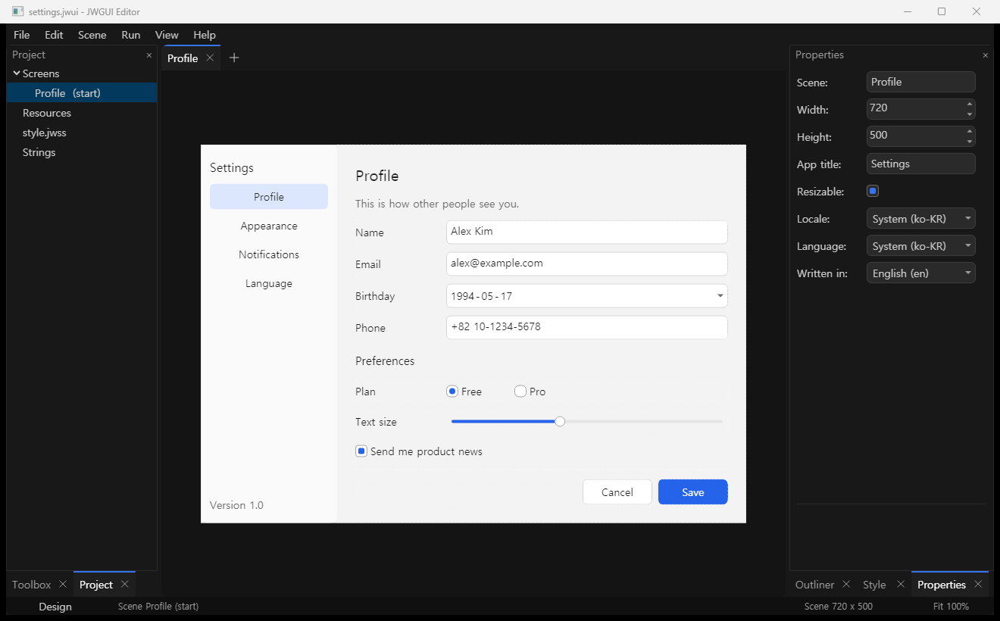
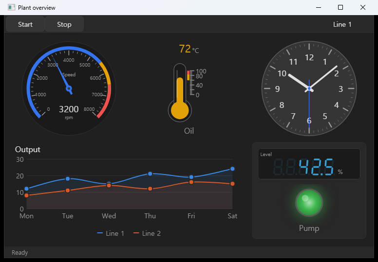
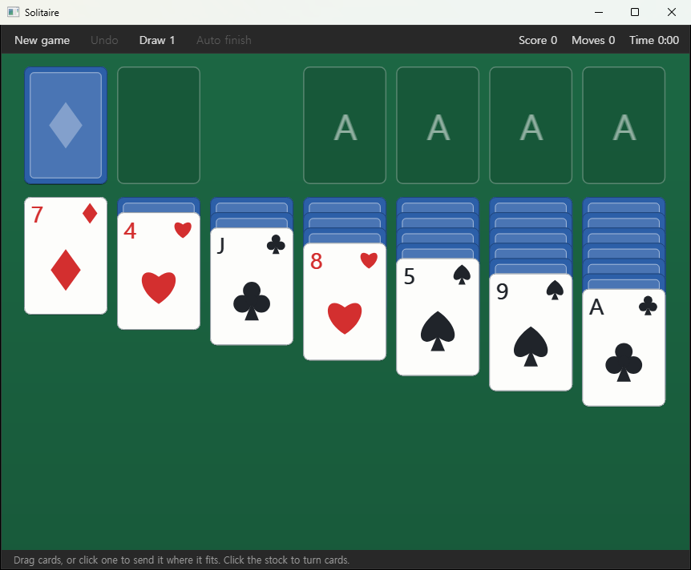
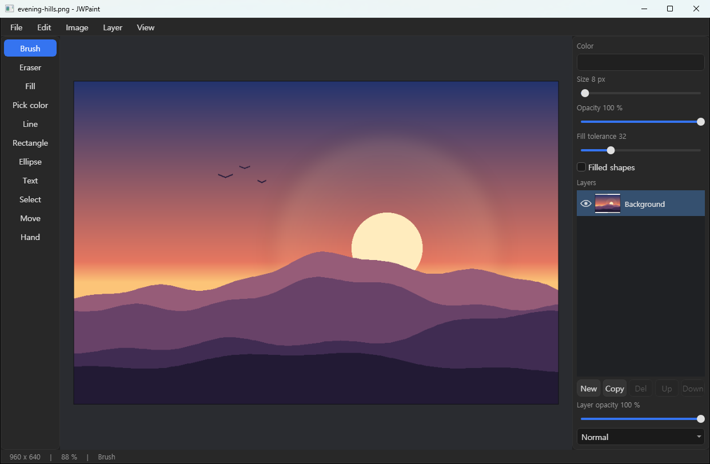
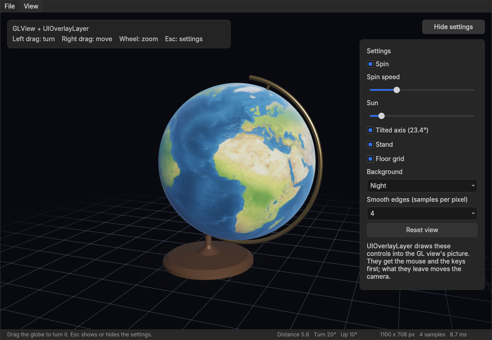

# JWGUIEngine

**A C++ GUI engine for Windows, Linux and macOS with a visual editor.** Design your screens in JWGUIEditor, save them as plain files, and let a C++ program load them and add the logic, or run them with no code at all in JWGUIPlayer. Spend your time on your app, not on its GUI.

[](#download)
[](#platforms)
[](#use-the-engine-from-c)
[](#license)

> **New in 1.0.3: Linux and macOS.** The engine, the editor, the player and the samples now run on **Windows, Linux (x64) and macOS (Apple silicon)**, from the same project files and the same C++ code. A screen designed on one system opens and runs on the others, and `find_package(JWGUIEngine)` builds your app on all three. Also new: the **GL View**, a control you draw in with OpenGL, with the engine's own controls over your 3D picture ([see below](#3d-views-and-ui-over-a-game)).

This repository is where JWGUIEngine is **released**. Each [release](https://github.com/dokdeplus/JWGUIEngine-Package/releases/latest) has a package for Windows, Linux and macOS: the engine (a shared library with headers and a CMake package), the editor, the player, sample apps and games, the user guide in English and Korean, and ready-to-build examples. Download the one for your system, unpack it, and it works. Nothing is installed in the system. The repository itself holds this page and the examples' source (`examples/`).



## What JWGUIEngine is for

Desktop developers lose a lot of time to screens: forms laid out by hand, a control the framework lacks written from scratch, pixels nudged until it looks right, and little of it carries over to the next project. JWGUIEngine is built to give that time back:

- **Design screens instead of coding them.** Lay out a window in the editor; it runs exactly as designed, drawn by the same engine that runs your app.
- **Screens are files, not code.** A project is a `.jwui` file (XML) plus a `res` folder with pictures, a CSS-like style sheet (`.jwss`) and string tables (JSON). Change the look or the layout and start the app again: no rebuild.
- **Your code stays about your program.** It meets the screen only through the names of the controls it uses (`FindByIdAs<UIButton>("saveButton")`).
- **Build a control once, use it in every project.** Your own controls are registered like the built-in ones and placed in any scene.
- **A polished look from the start.** Light and dark themes, a style sheet, smooth animation, per-monitor DPI, GPU or CPU drawing, text input with Korean / Japanese / Chinese input methods.

| | |
|---|---|
|  |  |
|  |  |

## One project, three systems

| | Windows | Linux | macOS |
|---|---|---|---|
| System | Windows 10 / 11, x64 | x64, glibc 2.38 or later (Ubuntu 24.04, Debian 13, Fedora 39 or newer) | macOS 11 or later, Apple silicon |
| Editor, player, samples | `bin\JWGUIEditor.exe`, ... | `bin/JWGUIEditor`, ... | `bin/JWGUIEditor.app`, ... |
| Your C++ app | MSVC x64 (Visual Studio 2026) | GCC 13 or Clang 17 (libstdc++) | Apple Clang (Xcode command line tools) |
| Build | CMake 3.20+ or `JWGUIEngine.props` | CMake 3.20+ | CMake 3.20+ |
| Export from the editor | a Windows program | a Linux program | a `.app` |

- **The same files everywhere.** `.jwui` screens, `.jwss` style sheets, string tables and pictures are the same on every system; nothing is converted.
- **The same C++.** The engine's interface is the same on all three, so your app's code builds on each with `find_package(JWGUIEngine)` and `jwgui_configure_app`.
- **Native where it matters.** Each system's own fonts (DirectWrite, fontconfig, Core Text), its input methods for Korean, Japanese and Chinese, its file dialogs and display scaling; on macOS the Command key does what Ctrl does on the others.

## 3D views and UI over a game



- **GL View (`UIGLView`)** is a control you draw in with OpenGL 3.3: put it in a window like any other control, draw your scene in its handler, and it composites with the rest of the window. For model viewers, an editor's 3D view, simulations and game screens.
- **`UIOverlayLayer`** draws the engine's controls (buttons, sliders, combo boxes, panels, edit boxes with input methods) over your own OpenGL picture: in a GL View, or in a game that has its own window and loop. The controls get the mouse and the keys first; what they leave is your game's. A replacement for an immediate-mode debug UI, with the same look as the rest of your app.
- **The `GLView3D` example** puts both together: a desk globe with a mouse camera, a settings panel over the 3D picture, a menu bar and a status bar. It is in every package **ready to run** (`bin\GLView3D.exe`, `bin/GLView3D`, `bin/GLView3D.app`) and as source in `examples/GLView3D`.
- Windows, Linux and macOS alike.

## Download

Download the package for your system from the [latest release](https://github.com/dokdeplus/JWGUIEngine-Package/releases/latest) (older versions are on the Releases page too):

| System | File |
|---|---|
| Windows 10 or 11, 64-bit | `Package-Release_<version>_<date>_windows-x64.zip` |
| Linux x64 (glibc 2.38 or later, for example Ubuntu 24.04) | `Package-Release_<version>_<date>_linux-x64.tar.gz` |
| macOS 11 or later, Apple silicon | `Package-Release_<version>_<date>_macos-arm64.zip` |

- Unpack it to a folder of your choice, for example `C:\JWGUI`. To write C++ apps on Windows: Visual Studio 2026 (MSVC x64) and CMake 3.20 or later; the `README.md` in the Linux and macOS packages says what those systems need.
- Start `bin\JWGUIEditor.exe` (Linux `bin/JWGUIEditor`, macOS `bin/JWGUIEditor.app`), or open the guide: `docs\index.html`.

| In the package | Contents |
|---|---|
| `bin\` | `JWGUIEditor.exe` (the visual editor), `JWGUIPlayer.exe` (runs a project with no code), `JWGUIPack.exe` (puts a project inside your program, encrypted), the sample apps and games, `GLView3D.exe` (the GLView3D example, ready to run), and `JWGUIEngine.dll` |
| `include\` | The engine's headers: `JWGUIEngine/Core`, `Controls`, `Layout`, `Scene` |
| `lib\` | `JWGUIEngine.lib` and `cmake\JWGUIEngine\` for `find_package(JWGUIEngine)` |
| `docs\` | The user guide: `docs\en\` (English), `docs\ko\` (Korean). Plain HTML, opens from disk, no server |
| `examples\` | `HelloScene`: a complete C++ app on this package, as a CMake project and as a Visual Studio project; `GLView3D`: a globe in a `UIGLView` with a mouse camera and `UIOverlayLayer` settings over it; `UIOverlayLayer`: the engine's controls over an OpenGL game of your own (Windows). The same examples are in this repository's `examples/` |
| `JWGUIEngine.props` | The engine for a Visual Studio project without CMake |
| `LICENSE`, `THIRD_PARTY_NOTICES.txt`, `VERSION.txt` | The terms, the parts written by others, the version |

The Linux and macOS packages have the same folders: `bin/` holds the programs (`.app` bundles on macOS) with `libJWGUIEngine.so` and `libSDL3.so.0` (Linux) or `libJWGUIEngine.dylib` and `libSDL3.0.dylib` (macOS), `lib/` the CMake package, and there is no `JWGUIEngine.props`.

## Quick start

**1. Design a screen.** Start `bin\JWGUIEditor.exe` (Linux `bin/JWGUIEditor`, macOS `bin/JWGUIEditor.app`). Place controls from the Toolbox, name the ones your code will touch, press **F5** to run the project in JWGUIPlayer, **File > Export** to make an app from it with no code for the system you are on. The guide's *Your first project* takes about ten minutes.

**2. Add the logic in C++.** A program loads the project and connects to its controls by name:

```cpp
#include "EntryPoint.h"          // gives Windows its WinMain; include it in one .cpp only
#include "SceneApplication.h"
#include "UIButton.h"
#include "UIEditBox.h"
#include "UIStatic.h"

using namespace jwgui;

class HelloApp : public SceneApplication {
protected:
    void OnSceneLoaded(const std::string& sceneId, UIRenderView* root) override {
        auto button = root->FindByIdAs<UIButton>("helloButton");
        auto edit = root->FindByIdAs<UIEditBox>("nameEdit");
        auto answer = root->FindByIdAs<UIStatic>("answer");
        if (!button || !edit || !answer) return;   // someone renamed a control
        button->ClickEvent.AddListener([edit, answer](UIRenderView*, const EventArgs&) {
            answer->SetText("Hello, " + edit->GetText() + "!");
        });
    }
};

int main(int argc, char** argv) {
    HelloApp app;
    app.SetProjectPath(argc > 1 ? argv[1] : "hello.jwui");
    return app.Run();
}
```

**3. Build it with CMake:**

```cmake
cmake_minimum_required(VERSION 3.20)
project(Hello LANGUAGES CXX)
find_package(JWGUIEngine 1.0 REQUIRED)
add_executable(Hello Main.cpp)
target_link_libraries(Hello PRIVATE JWGUIEngine::JWGUIEngine)
jwgui_configure_app(Hello)   # Windows: /MT and JWGUIEngine.dll next to the exe; Linux: the engine next to the program; macOS: a .app
```

```powershell
# Windows
cmake -S . -B build -A x64 -DCMAKE_PREFIX_PATH=C:\JWGUI
cmake --build build --config Release
```

```sh
# Linux and macOS
cmake -S . -B build -DCMAKE_BUILD_TYPE=Release -DCMAKE_PREFIX_PATH=$HOME/JWGUI
cmake --build build
```

`examples\HelloScene` is exactly this program, ready to build (also as `HelloScene.vcxproj` for Visual Studio without CMake: add `JWGUIEngine.props` through the Property Manager).

**4. Ship it.** `jwgui_configure_app(Hello PROJECT hello.jwui)` puts the project inside the program, encrypted with the project's key. Ship `Hello.exe` and `JWGUIEngine.dll` (no Visual C++ Redistributable needed), the program with `libJWGUIEngine.so` and `libSDL3.so.0` on Linux, or `Hello.app` on macOS; nothing has to be installed.

## Use the engine from C++

The engine's interface passes C++ standard library types, so a program is built the way the engine was. On Linux: GCC 13 or Clang 17 with libstdc++, C++17 or later. On macOS: Apple Clang, C++17 or later, the program a `.app`. On Windows: MSVC for x64, C++17 or later, the static runtime `/MT` in every configuration, `_ITERATOR_DEBUG_LEVEL=0`, `UNICODE`, `NOMINMAX`, `/utf-8`, the Windows subsystem. `find_package(JWGUIEngine)` + `jwgui_configure_app` (CMake) or `JWGUIEngine.props` (Visual Studio) set all of this.

Everything a scene can hold can also be made in code: panels with Flex, Grid or absolute layout, every control, menus, message boxes, docking panes, timers, work off the UI thread, file dialogs, saved settings. See the guide's *C++ guide*.

## What is in the box

- **Controls:** buttons, texts and pictures, edit boxes (single and multi-line, password, IME), check boxes, radio buttons, switches, combo boxes, lists, trees, sliders, spin boxes, progress bars, date and time input, calendar, tool bars and status bars; menus, message boxes, tabs, docking panes, a list view for very many rows, a code editor and a color picker from code.
- **Dashboard and machine-screen controls:** radial and linear gauges, thermometer, progress ring, lamps, stack lights, seven-segment displays, analog and digital clocks, bar / pie / line charts with live data. Values are colored by **zones** (`normal`, `ok`, `warn`, `alarm`).
- **Layout:** Absolute with anchors, Flex and Grid, in the editor and in code. Sizes in layout units; per-monitor DPI handled by the engine.
- **Styles:** Dark and Light themes computed from about thirty theme colors, and a CSS-like style sheet (`.jwss`) with types, classes, names, parts and states on top. Text color and font inherit as in CSS. In the editor, every style of a selected control is edited in the Style tab.
- **Languages and formats:** string tables (i18next JSON), `@id` texts in scenes, `Tr()` in code, plural forms; dates, times and numbers in the user's regional format or a locale the project fixes.
- **3D and games:** the GL View (`UIGLView`) for your own OpenGL drawing in a window, and `UIOverlayLayer` for the engine's controls over a 3D picture or a game of your own; game pads as input.
- **Shipping:** a project is exported from the editor as an app for Windows, Linux or macOS, or embedded in your program, always encrypted with the project's package key.
- **Samples, with source projects inside the package's programs:** JWView (picture viewer), JWNote (text editor), JWFiles (two- and three-pane file manager), JWPaint (paint program with layers); 2048, Minesweeper, Solitaire, Blocks, Alkkagi. Each is a `.jwui` project plus a small C++ program. And GLView3D, the 3D example above, ready to run.

## Documentation

The user guide is in the package (`docs\index.html`; English `docs\en\`, Korean `docs\ko\`), 38 pages: getting started (Windows, Linux and macOS), the editor, every control (the GL View too), concepts (projects and scenes, layout, styling, resources, languages, locale), the C++ guide (UI in a game or 3D view too), the player, file formats, working with AI agents. It is plain HTML and opens from disk.

## For AI agents

JWGUIEngine is developed with AI coding agents and is meant to be easy for an agent to build apps with:

- Everything is a text file: screens are XML (`.jwui`), looks are CSS-like (`.jwss`), words are JSON. No binary project files, no generated code, nothing to register. An agent can write a whole project and a person reviews it as a diff.
- A small, regular vocabulary: a control's type is its element name, its settings are attributes; layout is Absolute / Flex / Grid; style rules use CSS's words where CSS has the same thing.
- Mistakes are reported, not swallowed: a style sheet with an error still applies what reads and names the line and column; a project that cannot load shows why; unknown attributes are kept.
- A project runs without a build: `JWGUIPlayer.exe myapp.jwui --scene Settings`.

The guide's page *Working with AI agents* has the rules for writing a JWGUI project and what is planned (a `jwgui` command line with `check` and `render`, a machine-readable description of every control, `AGENTS.md` templates, `llms.txt`, a skill / MCP server, a Python bridge).

## Platforms

| | Status |
|---|---|
| **Windows 10 / 11 (x64), C++** | Available: the engine, JWGUIEditor, JWGUIPlayer and the samples |
| **Linux (x64), C++** | **Available since 1.0.3**: the same engine, editor, player and samples (glibc 2.38 or later: Ubuntu 24.04, Debian 13, Fedora 39 or newer) |
| **macOS 11 or later (Apple silicon), C++** | **Available since 1.0.3**: the same engine, editor, player and samples, as `.app` programs (not notarized yet: open them the first time with right-click > **Open**, or System Settings > Privacy & Security > **Open Anyway**) |
| C# (.NET) | Planned |
| Web browser (WebAssembly) | Planned |

## License

JWGUIEngine is released under the **MIT License** (`LICENSE`): use it in your own programs, commercial ones included, and ship apps made with it. The license covers what this package contains: the programs, the engine library with its headers, and the samples. The engine's source code is not public. Parts written by others (Skia, pugixml, fonts, ...) keep their own licenses, listed in `THIRD_PARTY_NOTICES.txt`.

## Versions

| Version | Date | Notes |
|---|---|---|
| 1.0.3 | 2026-11-07 | **Linux (x64) and macOS (Apple silicon)**: the engine, the editor, the player and the samples, as packages of their own with headers and the CMake package (`find_package(JWGUIEngine)` on all three); the editor's Export makes an app for the system it runs on. `ChildProcess` (run another program with its output on pipes) and `JsonValue` / `ParseJson`; game pads (`ReadGamepad`, pads as UI input); `UIGLView` (GL View), a control you draw in with OpenGL 3.3, with the `GLView3D` example (a globe with a mouse camera and settings over it, its source in `examples` and ready to run in `bin`); `UIOverlayLayer` for the engine's UI over a game of your own or a GL view (Windows, Linux, macOS); edit boxes center one line; tab strips shrink and scroll; `EventHandler::AddListener` returns an id for `RemoveListener`. Korean typing shows the first letter at once and text drawing is much faster with many Korean characters. JWFiles grew into a two- and three-pane file manager with archives, a home page and the system's icons. **Rebuild your app** against the 1.0.3 headers (class layouts changed). From this version the packages are the release's files (Windows, Linux, macOS); this repository keeps this page and the examples. |
| 1.0.2 | 2026-10-11 | Fixes from a review of the view core: a click on a card no longer reaches the control behind it, each window keeps its own focus, a disabled panel disables what is inside it, the default font is the system UI font, Shift + wheel scrolls sideways, scroll bars follow the theme. Clocks and gauges in a running app tick without the mouse (the timer queue was armed before the window existed). In the editor a click on the window selects it, a font picked in the Style tab reaches the controls inside, and the Font row lists the installed families. No style lookups while painting: the charts, gauges, indicators and clocks read cached values. New for custom controls: `RenderContent`, `OnStyleChanged`, `CachedPartColor` / `CachedPartFloat` / `CachedPartString` / `CachedPartBackground`, `StartTimer` / `StopTimer`. |
| 1.0.1 | 2026-10-10 | The editor starts in English until a language is chosen in View > Language (1.0.0 followed the OS language). |
| 1.0.0 | 2026-10-10 | First release: the engine, the editor, the player, the samples, the guide in English and Korean. Replaces the 0.1.0 preview. |

Keywords: C++ GUI engine, C++ GUI framework, cross-platform desktop UI, Windows, Linux, macOS, visual UI editor, WYSIWYG UI designer, Skia, GPU rendering, OpenGL view, game UI overlay (ImGui alternative), CSS-like style sheet, Flex and Grid layout, dashboard controls, gauges, charts, i18n, per-monitor DPI, MIT license, alternative to Qt / wxWidgets / WPF / MFC for C++ desktop apps, AI-agent-friendly UI framework.
